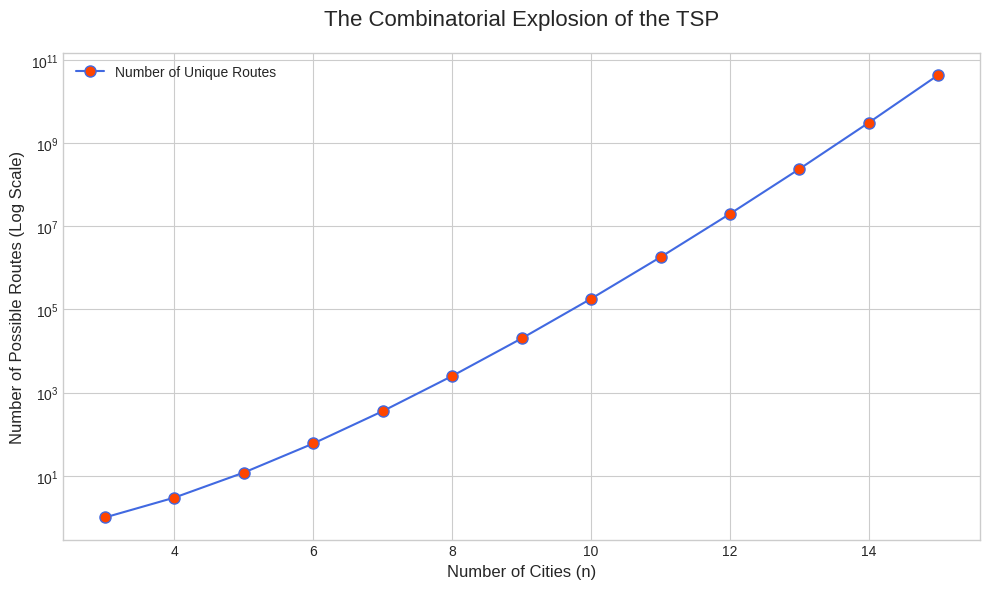
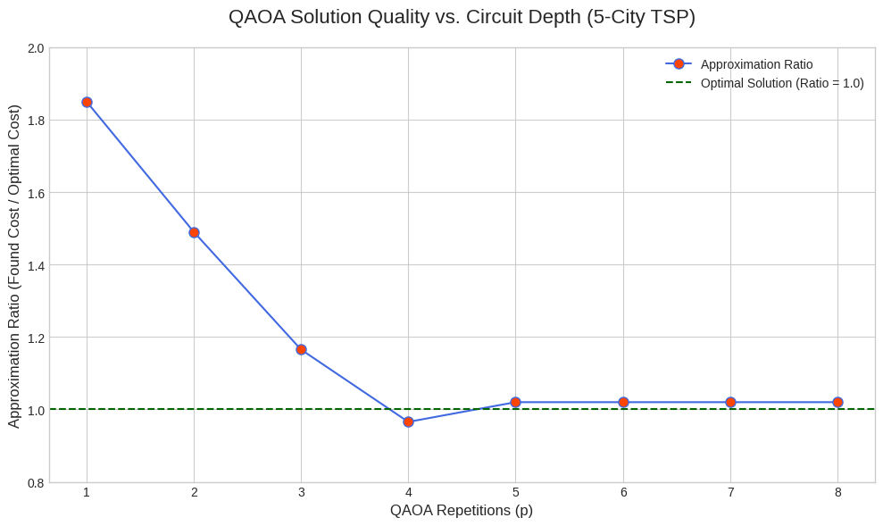
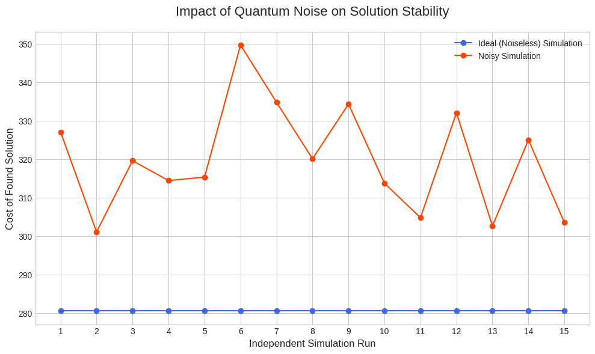

# Q-Route: Hybrid Quantum-Classical Route Optimisation for Drone Logistics

Q-Route solves the **Travelling Salesman Problem (TSP)** for drone delivery routes using the
**Quantum Approximate Optimization Algorithm (QAOA)**. Pick delivery points on an interactive map,
choose a quantum backend, and Q-Route returns the shortest visiting order. The backend can be an
ideal simulator, a noisy simulator or **real IBM Quantum hardware**.

> Research paper: *Quantum Approximate Optimization for Combinatorial Routing Problems in NISQ Systems* (first author, under review).


---

## Why quantum for routing?

The number of possible routes grows factorially with the number of stops. At 15 cities there are
already more than 10¹⁰ unique routes, so brute force stops being practical very quickly.



QAOA is a variational, hybrid algorithm built for today's noisy (NISQ) quantum computers.
A quantum circuit explores many candidate routes in superposition, and a classical optimiser
(COBYLA) tunes the circuit's parameters.

## How it works

```
Map (Leaflet.js)  ──►  Flask API (/optimize)  ──►  TSP as a QUBO  ──►  QAOA  ──►  Optimal route
   pick points          coordinates + backend       DOcplex model        Qiskit       drawn on map
```

1. **Distance matrix:** Euclidean distances between the selected points.
2. **QUBO formulation:** binary variable `x[i,p] = 1` if city *i* is visited at position *p*.
   The objective minimises total tour length, and constraints make sure every city is visited once and every
   position holds one city. This uses *n²* qubits (25 qubits for 5 cities).
3. **QAOA:** `qiskit_algorithms.QAOA` with `reps=5` and the COBYLA optimiser, wrapped in
   `MinimumEigenOptimizer`.
4. **Choice of backend:**
   | Backend | What it does |
   |---|---|
   | Ideal simulator | Noise-free `qiskit-aer` sampler |
   | Noisy simulator | Custom noise model: 5% bit-flip + phase-flip on 1-qubit gates, 5% depolarising on CX |
   | Real hardware | Least-busy IBM Quantum device through `qiskit-ibm-runtime` |
5. **Decode:** the best bitstring is turned back into a visiting order and drawn on the map.

## Results

**Circuit depth vs. solution quality (5-city TSP).** The approximation ratio (found cost ÷ optimal cost)
falls from 1.85 at *p = 1* to about 1.02 from *p = 5* onwards, which is why the app uses `reps=5`.



**Effect of hardware noise.** Across 15 runs the ideal simulator always finds the same optimal cost (≈281).
With the noise model, costs range from 301 to 350, roughly 7–25% worse. This is the main challenge for routing on today's NISQ devices.



## Tech stack

- **Quantum:** Qiskit, Qiskit Aer, Qiskit Algorithms, Qiskit Optimization, Qiskit IBM Runtime
- **Modelling:** DOcplex (QUBO formulation), NumPy
- **Backend:** Flask, Flask-CORS
- **Frontend:** HTML, CSS, JavaScript, Leaflet.js (interactive map)

## Project structure

```
Q-Route/
├── backend.py          # Flask API: QUBO formulation, QAOA solver, backend selection
├── requirements.txt
├── .env.example        # IBM Quantum token (only for real hardware)
├── frontend/
│   ├── index.html      # Landing page
│   ├── app.html/.js    # Interactive map + route optimiser
│   ├── features.html   # Feature overview
│   └── learn.html/.js  # "The Science Behind Q-Route" explainer
└── docs/images/        # Result plots
```

## Run it locally

```bash
git clone https://github.com/shubhreeka/Q-Route.git
cd Q-Route
python -m venv venv
venv\Scripts\activate          # Windows  (macOS/Linux: source venv/bin/activate)
pip install -r requirements.txt
python backend.py              # API at http://127.0.0.1:8000
```

Then open `frontend/index.html` in your browser, go to the app, choose 2–5 points and click **Optimise**.

**Using real IBM Quantum hardware (optional):** create a free account at
[quantum.ibm.com](https://quantum.ibm.com), copy your API token and set it before starting the backend:

```bash
copy .env.example .env                  # then put your token after IBM_QUANTUM_TOKEN= in .env (macOS/Linux: cp)
python backend.py
```

## Limitations and next steps

- Limited to **5 points**, because the *n²* encoding needs 25 qubits and simulation cost grows exponentially.
- Next: more compact encodings (e.g. *n log n*), warm-start QAOA, error mitigation on hardware, and the
  Vehicle Routing Problem (several drones).

## Author

**Shubhreeka Saxena**, B.Tech AI & ML, VIPS-TC (GGSIPU), Delhi
[LinkedIn](https://www.linkedin.com/in/shubhreeka-saxena/) · [GitHub](https://github.com/shubhreeka)
